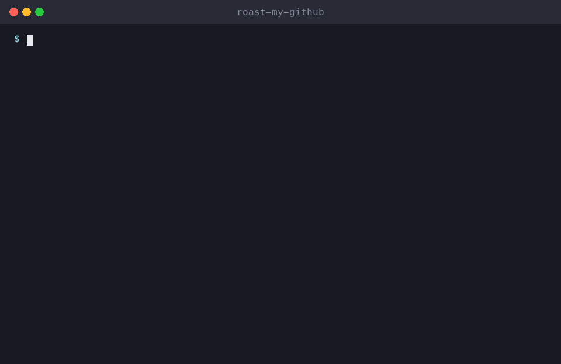

> [!NOTE]
> **This skill now lives in the main collection: [milad-ahmd/agent-skills](https://github.com/milad-ahmd/agent-skills/tree/main/skills/roast-my-github)**. Please ⭐ star it there; that's where updates land first.
> Docs: **https://milad-ahmd.github.io/agent-skills/skills/roast-my-github/** · Claude Code: `/plugin install all-skills --marketplace milad-ahmd/agent-skills`

<div align="center">

# 🔥 roast-my-github

**Get your GitHub profile roasted with real data, then a scorecard and glow-up plan. An Agent Skill for Claude Code, Cline, Cursor, Codex and other AI coding agents.**

[](LICENSE)
[](https://github.com/milad-ahmd/roast-my-github)


[Install](#-install) · [Usage](#-usage) · [How it works](skills/roast-my-github/SKILL.md) · [All skills](https://github.com/milad-ahmd/agent-skills)



</div>

> Part of **[agent-skills](https://github.com/milad-ahmd/agent-skills)**, a growing collection of practical skills for AI coding agents.

## 📦 Install

**One command (installs the whole collection):**

```bash
curl -fsSL https://raw.githubusercontent.com/milad-ahmd/agent-skills/main/install.sh | bash -s -- roast-my-github
```

**Manually (Claude Code):**

```bash
git clone https://github.com/milad-ahmd/roast-my-github /tmp/roast-my-github
mkdir -p ~/.claude/skills && cp -r /tmp/roast-my-github/skills/roast-my-github ~/.claude/skills/
```

**Per project:** copy `skills/roast-my-github` into `<project>/.claude/skills/`.
**Any other agent:** paste [`SKILL.md`](skills/roast-my-github/SKILL.md) into your rules or system prompt.

## 💬 Usage

Just ask your agent:

```text
Roast my GitHub: milad-ahmd
Rate my GitHub profile and tell me what to fix
```

The full workflow, rules and output format are in [`SKILL.md`](skills/roast-my-github/SKILL.md).

## 🧩 More skills

See the full collection: **[milad-ahmd/agent-skills](https://github.com/milad-ahmd/agent-skills)**.

## 🤝 Contributing

Issues and PRs are welcome, especially real-world before/after examples.

## 📄 License

[MIT](LICENSE) © Milad Ahmadi

<div align="center">

**If this skill saved you time, a ⭐ helps others find it.**

</div>
